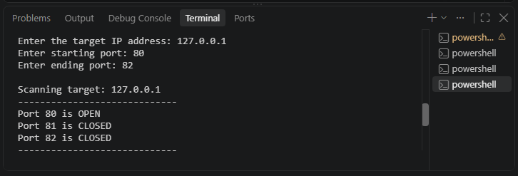
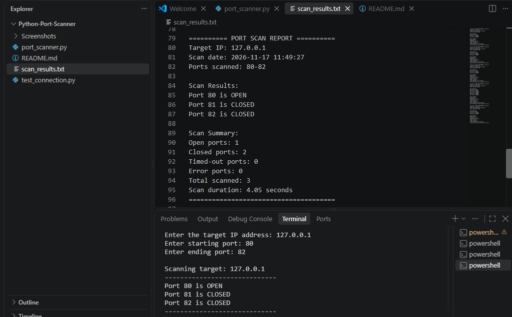

# Python Port Scanner

## Project Overview

A Python-based TCP port scanner developed to explore network communication, TCP connections, and basic network security concepts.

The tool allows users to scan a specified IPv4 address over a custom range of TCP ports, identify open and closed ports, detect connection timeouts, and save scan results to a text file.

## Features

- IPv4 address validation.
- Customisable TCP port scanning.
- Detection of open and closed ports.
- Connection timeout handling.
- Error handling for unexpected socket errors.
- Scan duration measurement.
- Scan summary with port counts.
- Automatic saving of scan reports to a text file.
- Maintains previous scan reports.

## Technologies Used

- Python 3
- Socket module
- IP Address module
- Datetime module
- Time module

**Development Environment:** Visual Studio Code

## Installation and Usage

### Prerequisites

- Python 3.x
- Visual Studio Code or another Python editor.

### Setup

1. Clone the repository:

   ```bash
   git clone https://github.com/Gichango/Python-Port-Scanner.git
   ```

2. Navigate to the project directory:

   ```bash
   cd Python-Port-Scanner
   ```

3. Run the scanner:

   ```bash
   python port_scanner.py
   ```

### Usage

1. Enter a valid IPv4 address when prompted.
2. Enter the starting port number.
3. Enter the ending port number.
4. The scanner displays the results and saves a report in `scan_results.txt`.

## Sample Output

```text
Welcome to my Python Port Scanner!
Enter the target IP address: 127.0.0.1
Enter starting port: 80
Enter ending port: 82

Scanning target: 127.0.0.1
-----------------------------
Port 80 is OPEN
Port 81 is CLOSED
Port 82 is CLOSED
-----------------------------
Scan completed!

Scan Summary
-----------------------------
Open ports: 1
Closed ports: 2
Timed-out ports: 0
Error ports: 0
Total scanned: 3
Scan duration: 0.02 seconds
```

*Note: Actual scan results and duration may vary depending on the target and network conditions.*

## Screenshots

### Port Scanning Results



### Saved Scan Report



## Future Development

The project is currently focused on TCP port scanning and basic network connectivity assessment.

Planned enhancements include:

- Service identification and version detection.
- Detection of potentially insecure network services.
- Basic security configuration checks.
- Integration with known vulnerability databases.
- Risk classification and detailed security assessment reports.

The long-term goal is to evolve the project into a basic network vulnerability assessment tool.

## Limitations

- Currently supports IPv4 addresses only.
- Scans TCP ports only.
- Does not currently perform vulnerability detection.
- Service identification and security assessment features are planned for future development.

## Responsible Use

This tool is intended for educational purposes and authorised network testing.

Only scan systems and networks that you own or have explicit permission to assess.
